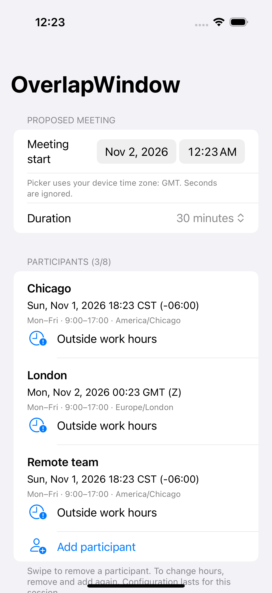

# OverlapWindow iOS

[](https://github.com/Talk2rakesh-1/overlap-window-ios/actions/workflows/ci.yml)

A native SwiftUI meeting-time workbench for distributed teams. Check a proposed meeting against participants' local working hours, find the next shared starts, and share a plain-text proposal. All calculations stay on-device.

**Functional portfolio MVP.** This checks declared working hours, not actual calendar availability. No account, backend, calendar permission, API key, or third-party runtime package.

## Run

Open `OverlapWindow.xcodeproj` in Xcode 16+ and run the OverlapWindow scheme on an iOS 17+ simulator. Physical-device runs require your own signing team. The Xcode project is committed; `project.yml` optionally regenerates it with XcodeGen.

1. Choose a proposed date/time in your device's time zone and a duration.
2. Review Chicago and London, or swipe to remove them.
3. Add up to eight named participants, choosing an IANA zone and same-day work hours.
4. Choose **Find next shared times** for up to five quarter-hour starts within seven elapsed days.
5. Tap a suggestion to use it; **Share proposal** opens the system share sheet.

Configuration lasts for the current app session. To change an existing participant, remove and re-add them. No persistence, calendar sync, scheduling service, or notifications are implemented.

## Time semantics

- Work days are Monday–Friday in each participant's zone. Holidays are not modeled.
- Work windows are start-inclusive/end-exclusive, with integer hours from 0 to 24; overnight shifts are not supported.
- The proposed start is truncated to a minute. Every occupied minute must fall within the work window; a meeting ending exactly at closing time is allowed.
- Foundation evaluates absolute instants in each IANA zone, so offset changes and local date boundaries are respected. Results depend on the OS time-zone database.
- Search uses a UTC quarter-hour grid from the ceiling of the selected instant, for seven elapsed 24-hour periods. It can miss starts outside that grid and does not rank fairness.
- Output includes local date, zone abbreviation, and numeric offset to distinguish repeated wall times.

Example: on November 2, 2026, 15:00 UTC is 09:00 in Chicago and 15:00 in London. A 30-minute meeting fits both default work windows.

## Simulator preview



Captured from the passing [CI UI smoke test](https://github.com/Talk2rakesh-1/overlap-window-ios/actions/runs/41366481495). The runner uses UTC; the participants retain their own local dates and offsets. Physical-device and broader accessibility checks remain follow-ups.

## Architecture

`SwiftUI session state → pure Participant validation / Planner → Foundation calendars → local status and share text`

The app compiles `Sources/OverlapCore` directly; SwiftPM tests the same source independently. Native forms, text labels, system controls and Dynamic Type provide a foundation for accessibility; manual VoiceOver and large-text checks remain necessary. Search is bounded and synchronous; profile larger workloads before expanding limits.

## Verify

```sh
swift test
xcrun swift-format lint --strict -r App Sources Tests UITests Package.swift
xcodebuild -project OverlapWindow.xcodeproj -scheme OverlapWindow \
  -sdk iphonesimulator -configuration Release CODE_SIGNING_ALLOWED=NO build analyze
# Use an installed simulator UUID:
xcodebuild -project OverlapWindow.xcodeproj -scheme OverlapWindow \
  -destination 'platform=iOS Simulator,id=YOUR-UUID' CODE_SIGNING_ALLOWED=NO test
```

Eight Swift Testing tests cover boundaries, daylight-saving offsets, half-hour zones, local weekdays, search, empty/no-overlap cases, invalid configuration, and second truncation. XCUITest exercises launch and adding a participant. [Verification](docs/VERIFICATION.md) distinguishes executed checks from limitations.

## Why this exists

Cross-time-zone coordination can push work outside normal hours. This project makes declared hours visible before a meeting proposal is sent; it claims no measured productivity improvement. [Research](docs/RESEARCH.md), [security](SECURITY.md), [licenses](THIRD_PARTY.md).

MIT licensed. No external datasets, assets or calendar content are bundled.
